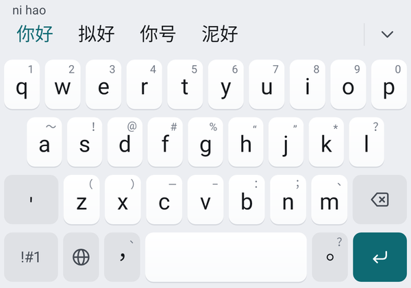
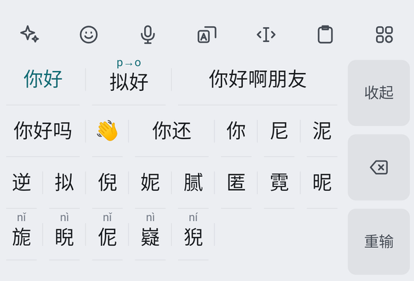
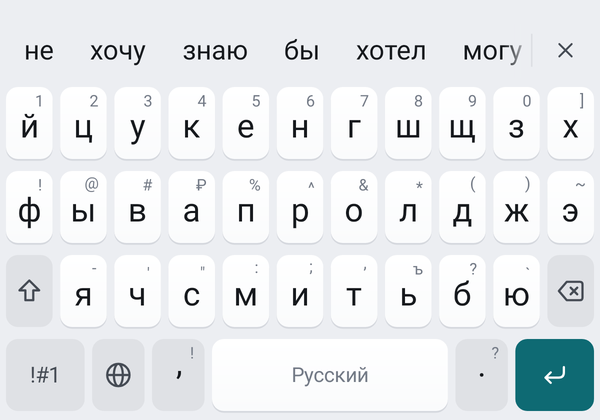
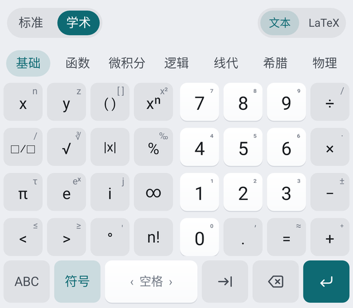
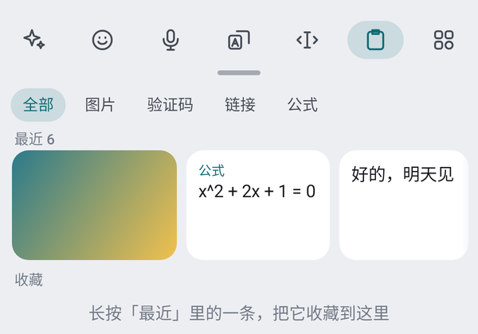
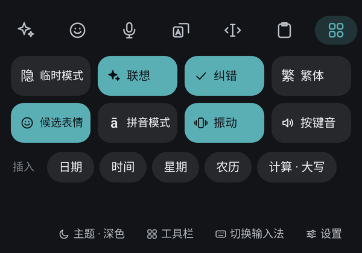

# KK输入法

一款为中文、俄语和英语混合书写而做的安卓输入法。中文基于 [Rime](https://github.com/rime/librime) 引擎与[雾凇拼音](https://github.com/iDvel/rime-ice)词库，键盘、面板和动效全部自绘。所有输入处理都在手机本地完成；AI 相关功能均为可选，使用你自己的 API Key。

<table>
  <tr>
    <td></td>
    <td></td>
    <td></td>
  </tr>
  <tr>
    <td></td>
    <td></td>
    <td></td>
  </tr>
</table>

## 功能

### 中文

- **整句输入**：雾凇拼音词库，支持中英混输、简拼、繁体输出和自定义短语。
- **按键纠错**：自研纠错器，处理按到相邻键、两个字母打反等失误，并用小字标出改动之处（p→o）；对缩写、人名等不确定的输入保持克制。
- **延迟学习**：上屏的词停留几秒后才计入学习，打错后立即删掉的内容不会被记住。
- **联想与回选**：上屏后推荐常接的词；删掉刚上屏的字，可按原拼音重新选择。
- **扩展词库**：语法模型、导入搜狗细胞词库、古诗文词库（约 3.8 万句，可按首字母打出整句，上屏后联想下一句）。
- **拼音模式**：输出带声调的拼音（nǐ hǎo），多音字按输入判断读音。

### 俄语与英语

- ЙЦУКЕН 与 QWERTY 键盘，句首自动大写、双击空格输入句号、俄语元音上滑输入重音字母。
- **补全与下一个词联想**：俄语约 6.7 万词、英语约 5.4 万词，按口语频率排序，并记住你常用的词、名字和写法（Андрей Леонидович、физфак МГУ）。
- **自动纠错**：只在按空格或标点时改正明显的单键失误（рпивет → привет、teh → the），词库中的词、你用过的词和名字都不会被改动；按一次删除键即可撤销。

### 面板与工具

- **数学键盘**：标准与学术两套布局，覆盖函数、微积分、逻辑、线性代数、希腊字母和物理单位，可输出 Unicode 或 LaTeX；带计算器。
- **剪贴板**：自动识别链接、验证码、号码、公式和图片，支持收藏与分类。
- **表情**：按 Unicode 官方分类，支持中英文关键词搜索、肤色与颜文字。
- **光标面板**：方向盘式移动与选择，按词跳转、行首行尾、全选复制粘贴。
- **语音输入**：本地离线识别（SenseVoice、Whisper），按停顿自动分句、补全标点；也可使用系统或云端识别。
- **翻译**：离线翻译（ML Kit）或 AI 翻译，可直接替换选中文字。
- **快捷面板**：临时模式、联想、纠错、繁体、拼音模式等开关，以及日期、时间、农历、金额大写等快捷插入。

### AI（可选）

填入 Claude、OpenAI、Gemini、DeepSeek、通义千问、Kimi、智谱等任一服务的 Key 后可用：

- **改写**：润色、纠错、改正式或口语、精简、扩写，或直接用一句话说明想怎么改。
- **云联想**：打字停顿时给出几种接下来的说法。
- **AI 候选**：长拼音输入时，由 AI 给出一个整句候选。

键盘自带请求限速，在服务提示额度不足时自动暂停。

### 隐私

- 密码框、地址栏和声明不学习的输入框里不会学习，也不会发出任何内容。
- **临时模式**：开启后键盘换色，输入内容不学习、不记录。
- 学习数据只保存在本机，可在设置里导出备份或一键清除。API Key 只保存在本机。

### 外观与手感

浅色、深色与纸张主题，多种主体色（含系统取色）；按键尺寸、字号、振动效果与强度均可调节；所有动画遵循系统的动画缩放设置。键盘布局使用 YAML 描述，每个键的滑动字符和长按选项都能在设置里修改。

## 安装

在 [Actions](../../actions) 页面下载最新构建的 `kk-shurufa` APK。安装后打开应用，按页面提示两步启用并切换为当前输入法。首次输入中文前会部署词库，约需一分钟，之后的更新只在词库内容变化时才重新部署。

需要 Android 8.0 或更高版本，目前提供 arm64 构建。

## 从源码编译

```bash
git clone --recursive https://github.com/kaichengkou/KK_ShuRuFa
cd KK_ShuRuFa
./gradlew assembleRelease        # 默认只编译 arm64；-PbuildAbi=all 编译全部架构
```

需要 JDK 17+、Android SDK 35、NDK 27.2.12479018 和 CMake 3.22.1。首次编译会下载 Boost 源码。

`./gradlew testDebugUnitTest` 运行全部单元测试，并将键盘、各面板与设置页的浅色和深色截图渲染到 `app/build/screens/`。

## 项目结构

| 路径 | 内容 |
| --- | --- |
| `app/src/main/java/com/kk/shurufa/ime` | 输入法服务：面板调度、候选栏、按键路由；表情、剪贴板、翻译、AI、语音各为独立模块 |
| `app/src/main/java/com/kk/shurufa/keyboard` | 自绘键盘、手势、候选栏与各面板；设计系统（字号、颜色、动效曲线、弹簧） |
| `app/src/main/java/com/kk/shurufa/rime` | Rime 引擎的启动、部署与词库管理 |
| `app/src/main/java/com/kk/shurufa/settings` | 设置界面（Jetpack Compose） |
| `app/src/main/assets/layouts` | 键盘布局（YAML） |
| `app/src/main/jni` | librime、whisper.cpp 及依赖的编译脚本与 JNI 桥 |
| `rime-data` | 雾凇拼音（子模块）与本项目的覆盖配置、Lua 过滤器 |
| `scripts` | 联想词表、声调表、表情与古诗文数据的生成脚本 |

## 致谢

本项目建立在以下开源项目和数据之上：

| 项目 | 用途 | 许可 |
| --- | --- | --- |
| [librime](https://github.com/rime/librime)、[librime-lua](https://github.com/hchunhui/librime-lua)、[librime-octagram](https://github.com/lotem/librime-octagram) | 中文输入引擎 | BSD-3-Clause / BSD-3-Clause / GPL-3.0 |
| [雾凇拼音 rime-ice](https://github.com/iDvel/rime-ice) | 中文词库与方案 | GPL-3.0 |
| [OpenCC](https://github.com/BYVoid/OpenCC) | 简繁转换 | Apache-2.0 |
| [pinyin-data](https://github.com/mozillazg/pinyin-data) | 拼音声调 | MIT |
| [chinese-poetry](https://github.com/chinese-poetry/chinese-poetry) | 古诗文词库 | MIT |
| [FrequencyWords](https://github.com/hermitdave/FrequencyWords)、[Tatoeba](https://tatoeba.org) | 俄语、英语词频与联想 | CC-BY-SA-4.0 / CC-BY 2.0 FR |
| [SenseVoice](https://github.com/FunAudioLLM/SenseVoice)、[whisper.cpp](https://github.com/ggml-org/whisper.cpp)、[Silero VAD](https://github.com/snakers4/silero-vad)、[ONNX Runtime](https://github.com/microsoft/onnxruntime) | 本地语音识别 | 见各项目 |
| [Unicode Emoji](https://unicode.org/emoji/) | 表情分类与名称 | Unicode License |
| [ML Kit Translation](https://developers.google.com/ml-kit/language/translation) | 离线翻译 | Google APIs Terms |

编译方案参考了 [Trime](https://github.com/osfans/trime)。
